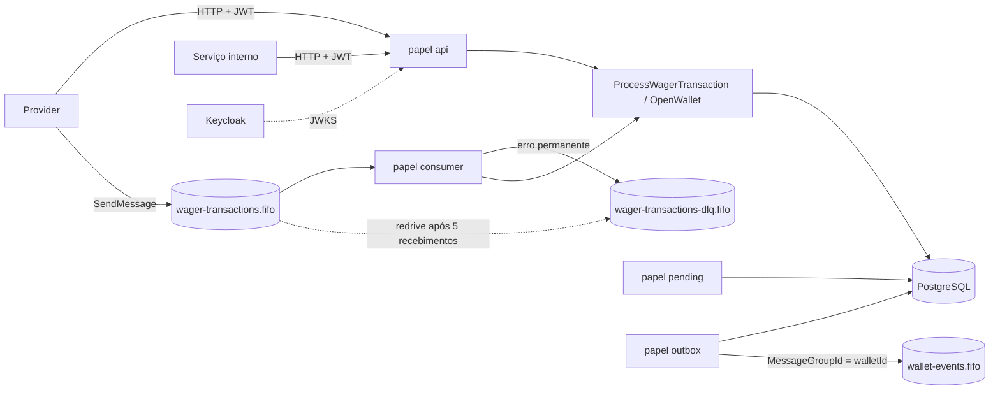
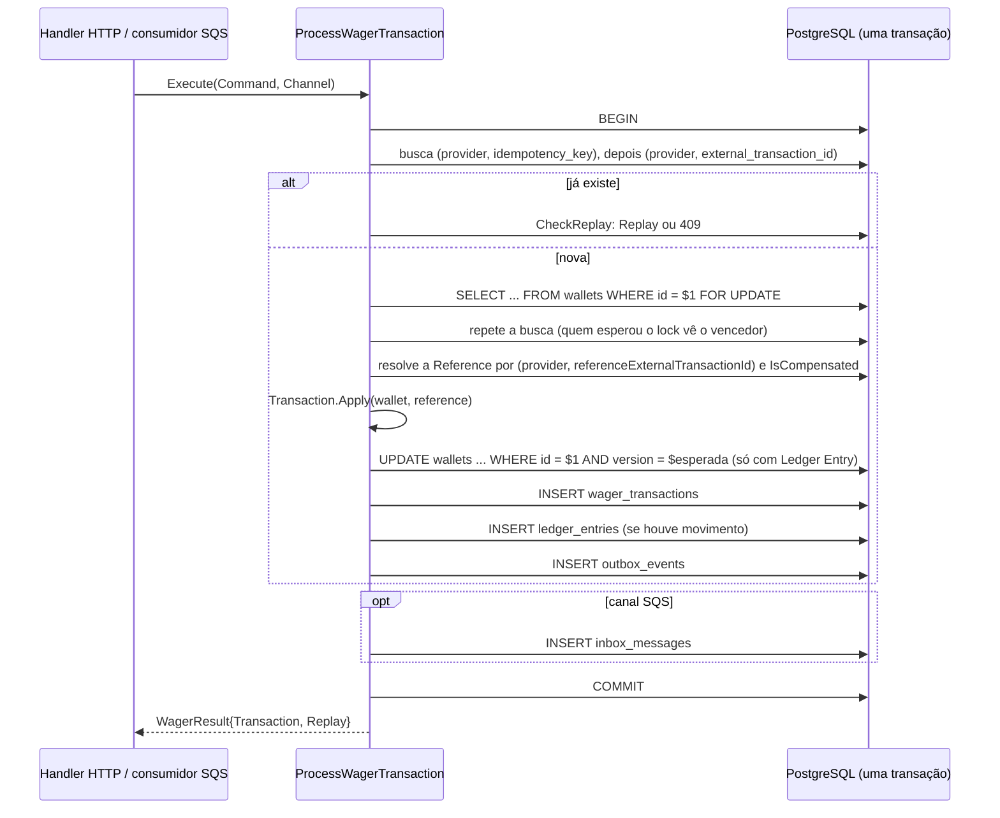
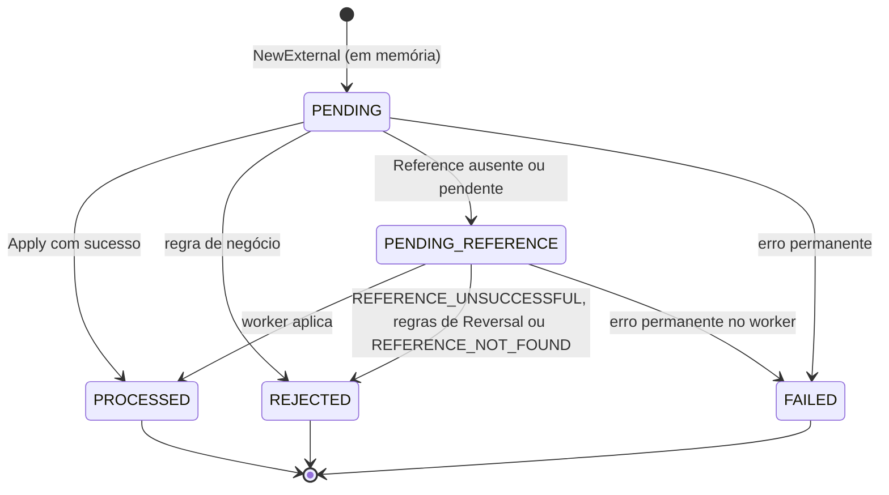

# Arquitetura

Este documento registra como o Wallet & Wagering Service funciona e por quê. Ele descreve o comportamento do código em `internal/`, `migrations/` e `deploy/`; onde a implementação interpreta ou diverge do enunciado ([CHALLENGE.md](CHALLENGE.md)), a seção [Limitações e decisões de interpretação](#limitações-e-decisões-de-interpretação) explica. O vocabulário segue o glossário [CONTEXT.md](CONTEXT.md); as decisões com alternativas descartadas estão em [docs/adr/](docs/adr/). Comandos de execução e testes ficam no [README.md](README.md).

## Sumário

1. [Visão geral](#visão-geral)
2. [Pacotes e dependências](#pacotes-e-dependências)
3. [Dinheiro (Money)](#dinheiro-money)
4. [Transações SQL e unidade de trabalho](#transações-sql-e-unidade-de-trabalho)
5. [Locks e concorrência](#locks-e-concorrência)
6. [Máquina de estados da Wager Transaction](#máquina-de-estados-da-wager-transaction)
7. [Idempotência e Payload Hash](#idempotência-e-payload-hash)
8. [Operações, References e Failure Codes](#operações-references-e-failure-codes)
9. [Reversals e Compensation Slot](#reversals-e-compensation-slot)
10. [Pending References e worker](#pending-references-e-worker)
11. [Outbox](#outbox)
12. [Inbox e consumidor SQS](#inbox-e-consumidor-sqs)
13. [Autenticação](#autenticação)
14. [Autorização](#autorização)
15. [Composição Fx e papéis](#composição-fx-e-papéis)
16. [Shutdown ordenado](#shutdown-ordenado)
17. [Observabilidade](#observabilidade)
18. [Contratos HTTP](#contratos-http)
19. [Schema do banco](#schema-do-banco)
20. [Estratégia de testes](#estratégia-de-testes)
21. [Limitações e decisões de interpretação](#limitações-e-decisões-de-interpretação)
22. [Índice de ADRs](#índice-de-adrs)

## Visão geral

Um único binário (`cmd/app`) roda qualquer combinação de quatro papéis, escolhidos por `APP_ROLES`: `api` (HTTP), `consumer` (fila `wager-transactions.fifo`), `outbox` (publicação em `wallet-events.fifo`) e `pending` (retomada de Pending References). Todo estado vive no PostgreSQL; nenhuma instância guarda estado em memória que outra precise. Três processos independentes com todos os papéis são o cenário testado em `test/e2e`.



Stack:

| Responsabilidade | Escolha |
| --- | --- |
| Linguagem | Go 1.27.1 (`go.mod` e `Dockerfile`) |
| Composição | Uber Fx (`go.uber.org/fx`), um `fx.Module` por área |
| HTTP | `net/http` com os padrões de rota do `ServeMux` (`"POST /wallets"`) |
| Banco | PostgreSQL 17 com `pgx/v5` (`pgxpool`) e SQL explícito, sem ORM nem `sqlc` |
| Migrations | `golang-migrate`, arquivos `migrations/NNNNNN_*.{up,down}.sql` |
| Mensageria | AWS SDK v2 (`service/sqs`) contra MiniStack no ambiente local |
| Autenticação | Keycloak 26 (`client_credentials`), validação local com `golang-jwt/jwt/v5` e `MicahParks/keyfunc/v3` |
| Observabilidade | `log/slog` em JSON e `prometheus/client_golang` em `/metrics` |

## Pacotes e dependências

```text
cmd/app              lê a config e roda o app Fx
internal/config      variáveis de ambiente, validação, papéis
internal/bootstrap   raiz de composição Fx (bootstrap.Options, roleModules)
internal/domain/...  money, wallet, ledger, wager, event: domínio puro
internal/app         casos de uso e portas (UnitOfWork, repositórios, métricas)
internal/postgres    pool, repositórios, UnitOfWork, stores dos workers
internal/httpapi     servidor, handlers, autenticação, corpo de erro
internal/sqs         cliente, consumidor da entrada, publisher de eventos
internal/worker      Loop, Backoff, publisher da outbox, worker de pendências
internal/crashpoint  pontos nomeados de injeção de falha (build tag faultinject)
internal/health      /health/live e /health/ready
internal/observability  logger JSON, registry Prometheus, implementações das portas de métricas
```

O domínio importa apenas a biblioteca padrão e `github.com/google/uuid`; o teste `TestDomainHygiene` (`internal/domain/wager/hygiene_test.go`) falha se um pacote de domínio importar Fx, HTTP, SQS ou pgx. As entidades têm estado privado, construtores com validação (`wallet.New`, `wager.NewExternal`, `wager.NewOpening`, `ledger.New`) separados da reidratação (`wallet.Rehydrate`, `wager.Rehydrate`), que apenas restaura e valida o estado sem reaplicar movimentações, transições ou eventos. Erros de domínio são sentinelas e tipos classificáveis por `errors.Is`/`errors.As` (`money.ErrOverflow`, `wager.ErrInvalidCommand`, `*wager.RejectionError`, ...); rejeições de negócio nunca usam `panic`.

## Dinheiro (Money)

`money.Money` é um value object imutável: `int64` em unidades mínimas mais `money.Currency`.

- **Escala fixa de duas casas** para todas as moedas. Limites: de `-92233720368547758.08` a `92233720368547758.07`.
- **Moeda**: código ISO 4217 validado contra uma lista fixa de códigos ativos (`internal/domain/money/currency.go`), somente em maiúsculas.
- **Parsing**: aceita apenas a forma canônica `^(0|[1-9][0-9]*)\.[0-9]{2}$`. Vazio, sinal, `NaN`, `Infinity`, notação científica, espaços, zeros à esquerda, escala diferente de duas casas e valores fora do `int64` falham com `ErrInvalidAmount`. Não há arredondamento nem normalização; por isso o Payload Hash usa a string recebida sem transformação.
- **Aritmética**: `Add`, `Sub`, `Neg`, `Compare` e `Equal` exigem a mesma moeda (`ErrCurrencyMismatch`) e detectam overflow (`ErrOverflow`). O valor zero do tipo é inválido (`ErrUninitialized`) em qualquer operação.
- **JSON**: `{"amount":"25.00","currency":"BRL"}` nas duas direções. A decodificação rejeita número JSON, `null`, campo ausente e campo extra. Valores negativos existem só em cálculos internos (por exemplo `difference` da Reconciliation) e são serializados como `"-5.00"`.
- **Persistência**: colunas `<nome>_minor BIGINT` mais `currency CHAR(3)`. Nenhum `float32`/`float64` aparece no caminho do dinheiro.

Política de zero (validada em `wager.NewCommand`): BET, WIN, REFUND e ROLLBACK exigem valor maior que zero; LOSS exige exatamente `"0.00"`; a abertura aceita saldo inicial zero.

## Transações SQL e unidade de trabalho

A porta `app.UnitOfWork` delimita uma transação SQL:

```go
Do(ctx context.Context, fn func(ctx context.Context, tx app.Tx) error) error
```

`postgres.UnitOfWork` implementa com `pgx.BeginFunc` em `READ COMMITTED`: commit quando `fn` retorna `nil`, rollback em erro ou panic. `app.Tx` entrega os repositórios ligados à mesma `pgx.Tx`: `Wallets()`, `Transactions()`, `Ledger()`, `Outbox()`, `Pending()` e `Inbox()`. Os casos de uso nunca veem `pgx`; o repositório é quem conhece o SQL.

Cada operação sem dependência pendente é validada, aplicada e concluída em uma transação ([ADR-0001](docs/adr/0001-synchronous-processing.md)), sem commit intermediário de `PENDING`. A ordem de escrita dentro de `Do` é fixa: Wallet, Wager Transaction, Ledger Entry, Outbox Events e, no canal SQS, a Inbox Message.



Classificação de erros (`postgres.classify`): conexão (classe `08`), `40001` (serialização), `40P01` (deadlock), `57P01`-`57P03`, `53300`, timeouts e erros de rede viram `app.ErrTransient`. Violações de constraints conhecidas viram erros tipados (`ErrWalletAlreadyExists`, `ErrDuplicateTransaction`, `ErrCompensationConflict`, `ErrInboxMessageExists`). Qualquer outro erro é tratado como permanente (ver [Máquina de estados](#máquina-de-estados-da-wager-transaction)).

Leituras fora de transação (consultas de Wallet, ledger e Wager Transaction) usam repositórios ligados ao pool. A Reconciliation usa sua própria porta (`app.ReconciliationReader`) com uma transação `REPEATABLE READ READ ONLY`, para que saldo armazenado e soma do ledger venham do mesmo snapshot.

## Locks e concorrência

Coordenação por Wallet com lock pessimista de linha e verificação de versão ([ADR-0003](docs/adr/0003-wallet-concurrency.md)):

1. `SELECT ... FROM wallets WHERE id = $1 FOR UPDATE` serializa os escritores de uma mesma Wallet até o fim da transação. Carteiras distintas usam linhas distintas e avançam em paralelo; não existe lock global nem lock em memória.
2. O agregado `wallet.Wallet` aplica `Debit`/`Credit`, que devolvem o Ledger Entry com saldo anterior e posterior e incrementam a versão (a Opening mantém a versão 1).
3. `UPDATE wallets SET balance, version, updated_at WHERE id = $1 AND version = $esperada`. Zero linhas afetadas vira `app.ErrConcurrencyConflict` (envolve `ErrTransient`), incrementa `wallet_concurrency_conflicts_total` e responde 503 ou devolve a mensagem à fila. Com o lock, esse caminho é defesa em profundidade.
4. O banco garante as invariantes por conta própria: `CHECK (balance >= 0)`, `UNIQUE (player_id, currency)`, `UNIQUE (wallet_id, transaction_id)` no ledger, as unicidades de idempotência e os índices do Compensation Slot. Nenhuma garantia financeira depende da deduplicação do SQS FIFO ou de coordenação em memória.

Corridas sem linha para bloquear (duas requisições para uma Wallet inexistente, ou duas instâncias com a mesma operação) são resolvidas pelas constraints únicas: o perdedor recebe `ErrDuplicateTransaction`, a transação inteira faz rollback e `Execute` tenta mais uma vez; a segunda tentativa encontra o vencedor e responde como Replay ou conflito. Duas aberturas simultâneas do mesmo par (jogador, moeda) resultam em uma Wallet: o perdedor recebe `409 WALLET_ALREADY_EXISTS`, e a Opening, o ledger e os eventos dele somem no rollback.

Cenários comprovados: duas BETs de 80.00 sobre 100.00 (uma `PROCESSED`, uma `INSUFFICIENT_FUNDS`, saldo 20.00, um débito), a mesma BET 50 vezes em paralelo (um débito, 49 Replays), Wallets distintas em paralelo, a mesma operação por HTTP e SQS ao mesmo tempo, todos com três processos em `test/e2e`.

## Máquina de estados da Wager Transaction



- `wager.Status.CanTransitionTo` codifica a tabela; terminais (`PROCESSED`, `REJECTED`, `FAILED`) recusam qualquer transição com `ErrInvalidTransition`.
- `PENDING` existe só dentro da transação SQL que cria o registro (ADR-0001): nenhuma linha `PENDING` é confirmada. O único estado intermediário persistido é `PENDING_REFERENCE`, retomado pelo worker. O schema aceita `PENDING` no `CHECK`, e a API responderia `202` para ele, mas nenhum caminho o grava.
- A Opening nasce e termina `PROCESSED` dentro da abertura da Wallet.

**Transitório versus permanente.** `app.ErrTransient` cobre falhas que uma nova tentativa resolve (banco indisponível, timeout, serialização, deadlock, conflito de versão, corrida da inbox). Elas nunca produzem registro: tudo faz rollback e o cliente recebe `503` com `Retry-After`, ou a mensagem volta à fila com backoff. Um erro que não é transitório, cancelamento de contexto, desfecho de idempotência, corrida perdida nem comando inválido é permanente (`app.isPermanent`): um overflow na soma do saldo ou uma violação de `CHECK` inesperada. Nesse caso `ProcessWagerTransaction` grava a operação como `FAILED` com Failure Code `PERMANENT_ERROR` em uma transação separada, para auditoria e para que o Replay devolva o mesmo desfecho. `FAILED` não gera Outbox Event. No SQS, depois do registro a mensagem vai para a DLQ com `dlqReason=permanent_error`.

## Idempotência e Payload Hash

A idempotência é persistente: vive nas colunas e constraints de `wager_transactions` e sobrevive ao reinício de todas as instâncias.

- `Idempotency-Key` (HTTP) ou `data.idempotencyKey` (SQS) é obrigatória, gravada exatamente como enviada (até 255 bytes, sem espaços nas pontas) e única por Provider: `UNIQUE (provider_id, idempotency_key)`. O servidor nunca a substitui por uma chave calculada.
- `UNIQUE (provider_id, external_transaction_id)` impede aplicar a mesma operação com outra chave.
- A busca olha primeiro `(provider, key)` e depois `(provider, externalTransactionId)`; `wager.CheckReplay` decide:

| Situação | Resultado |
| --- | --- |
| Mesma chave, mesmo Payload Hash | Replay: resultado persistido (status, `failureCode`, saldo da época), mesmo status HTTP, `idempotentReplay: true`, sem ledger nem eventos |
| Mesma chave, hash diferente | `409 IDEMPOTENCY_KEY_CONFLICT` (SQS: DLQ `idempotency_key_conflict`) |
| Outra chave, mesmo `externalTransactionId` | `409 EXTERNAL_TRANSACTION_CONFLICT` (SQS: DLQ `external_transaction_conflict`) |
| Mesma chave enviada por outro Provider | Outra operação, independente |

O Replay devolve o saldo gravado em `balance_after_minor`/`balance_after_currency` no processamento original, mesmo depois de outras movimentações. HTTP e SQS montam o mesmo `wager.Command`, então uma operação enviada por um canal e repetida pelo outro é um Replay.

### Forma canônica do Payload Hash

`wager.PayloadHash` é o SHA-256, em hexadecimal minúsculo, de `wager.CanonicalPayload`:

- Um objeto JSON com os campos de negócio: `externalTransactionId`, `gameId`, `kind`, `money` (objeto aninhado com `amount` e `currency`), `playerId`, `providerId`, `referenceExternalTransactionId` e `roundId`, `walletId`.
- Chaves em ordem de bytes em todos os níveis, sem espaços insignificantes, sem quebra de linha final, UTF-8.
- Todos os valores são strings JSON. `money.amount` é a string canônica recebida (o parser só aceita essa forma). `playerId` e `walletId` são UUIDs canônicos com hífens, normalizados para minúsculas. As demais strings entram exatamente como recebidas.
- `referenceExternalTransactionId` é omitido quando ausente.
- Escape de `encoding/json` com escape de HTML desligado: só `"`, `\` e caracteres de controle são escapados.
- Ficam fora: a Idempotency Key e todo metadado de transporte (headers, `messageId`, `type`, `occurredAt`, `correlationId` do envelope, claims do token).

Exemplo (BET do enunciado):

```json
{"externalTransactionId":"transaction-123","gameId":"fortune-chimp","kind":"BET","money":{"amount":"25.00","currency":"BRL"},"playerId":"0192f28f-5dc0-7d58-bdb2-814ad6a0f4a1","providerId":"provider-a","roundId":"round-987","walletId":"0192f291-27dd-7d3f-8071-5f8685deef37"}
```

`payload_hash = 629836932b79106b99523d06a1e7fa80689b0ea1e1c47aa3f0a5a2c87d0c4344`. O schema exige `payload_hash ~ '^[0-9a-f]{64}$'`.

## Operações, References e Failure Codes

| Tipo | Movimento | Regras de formato (400 sem registro) |
| --- | --- | --- |
| `BET` | Débito | valor > 0; sem `referenceExternalTransactionId` |
| `WIN` | Crédito | valor > 0; `referenceExternalTransactionId` opcional, deve apontar uma BET |
| `LOSS` | Nenhum | exatamente `"0.00"`; sem `referenceExternalTransactionId` |
| `REFUND` | Crédito | valor > 0; `referenceExternalTransactionId` obrigatório |
| `ROLLBACK` | Contrário ao da Reference | valor > 0; `referenceExternalTransactionId` obrigatório |
| `OPENING` | Crédito inicial | recusado por HTTP (400) e SQS (DLQ `opening_kind`) |

Outras regras de formato de `wager.NewCommand`: identificadores obrigatórios, até 255 bytes, UTF-8, sem espaços nas pontas; `playerId` e `walletId` UUIDs canônicos de 36 caracteres e diferentes do UUID nulo; a Reference não pode ser a própria operação.

`Transaction.Apply` avalia, nesta ordem: Wallet inexistente (`WALLET_NOT_FOUND`), jogador diferente do dono da Wallet (`WALLET_PLAYER_MISMATCH`), moeda diferente da Wallet (`CURRENCY_MISMATCH`), regras de Reference (`wager.ResolveReference`) e, por último, saldo. A Reference é procurada por `(providerId, referenceExternalTransactionId)` com a Wallet bloqueada; a de outro Provider é invisível. `LOSS` processada gera só `WagerTransactionProcessed`, sem Ledger Entry, sem `WalletBalanceChanged` e sem mudar a versão da Wallet.

### Failure Codes

Códigos estáveis de `wager.FailureCode` ([ADR-0005](docs/adr/0005-failure-codes-and-http-status.md)). **Corrigível**: o Provider pode enviar uma nova operação corrigida. **Definitivo**: o desfecho vale qualquer que seja o próximo envio. A classe também sai no evento `WagerTransactionRejected` (`correctable`).

| Código | Classe | HTTP | Situação |
| --- | --- | --- | --- |
| `INSUFFICIENT_FUNDS` | definitivo | 422 | BET acima do saldo |
| `REVERSAL_INSUFFICIENT_FUNDS` | definitivo | 422 | ROLLBACK (de WIN ou de REFUND) que debitaria além do saldo |
| `WALLET_NOT_FOUND` | corrigível | 422 | Wallet inexistente (registro persistido, `balance: null`) |
| `WALLET_PLAYER_MISMATCH` | corrigível | 422 | `playerId` diferente do dono da Wallet (`balance: null`) |
| `CURRENCY_MISMATCH` | corrigível | 422 | Moeda da operação diferente da Wallet |
| `REFERENCE_NOT_FOUND` | definitivo | 422 | Tentativas de Pending Reference esgotadas (`balance: null`) |
| `REFERENCE_UNSUCCESSFUL` | definitivo | 422 | Reference terminou `REJECTED` ou `FAILED` |
| `REFERENCE_MISMATCH` | corrigível | 422 | Jogador, Wallet, moeda ou Round diferentes da Reference; WIN cuja Reference não é BET |
| `REFERENCE_AMOUNT_MISMATCH` | corrigível | 422 | Valor do Reversal diferente do valor da Reference |
| `REFERENCE_NOT_REVERSIBLE` | definitivo | 422 | ROLLBACK de ROLLBACK, REFUND de WIN/REFUND/ROLLBACK, Reversal de LOSS |
| `REFERENCE_ALREADY_COMPENSATED` | definitivo | 422 | Compensation Slot já consumido ou Reference já revertida |
| `PERMANENT_ERROR` | definitivo | 500 | Status `FAILED`: falha permanente de infraestrutura, registrada para auditoria |

## Reversals e Compensation Slot

REFUND e ROLLBACK seguem o mesmo caminho das outras operações (`ProcessWagerTransaction` e `wager.ResolveReference`), com estas regras ([ADR-0002](docs/adr/0002-compensation-slot.md)):

| Reversal | Efeito | Consome o slot da BET |
| --- | --- | --- |
| `REFUND` de BET | crédito do valor da BET | sim |
| `ROLLBACK` de BET | crédito do valor da BET | sim |
| `ROLLBACK` de WIN | débito do valor do WIN | não |
| `ROLLBACK` de REFUND | débito de volta; o slot da BET continua consumido | não |
| demais combinações | `REFERENCE_NOT_REVERSIBLE` | não |

Verificações em ordem: compatibilidade de tipo; status da Reference (ausente, `PENDING` ou `PENDING_REFERENCE` leva a esperar, `REJECTED`/`FAILED` leva a `REFERENCE_UNSUCCESSFUL`); jogador, Wallet, moeda e Round; valor igual (reversões parciais ficam fora); Reference já revertida (`REFERENCE_ALREADY_COMPENSATED`).

`IsCompensated(refID)` é verdadeiro quando existe uma linha com `compensated_bet_id = refID` ou um REFUND/ROLLBACK `PROCESSED` com `reference_transaction_id = refID`. Reversals concorrentes da mesma BET são serializados pelo lock da Wallet (a Reference pertence à mesma Wallet do Reversal). Os índices únicos parciais são a garantia final:

- `wager_transactions_compensated_bet_key`: `UNIQUE (compensated_bet_id) WHERE compensated_bet_id IS NOT NULL`. `compensated_bet_id` só é preenchido em REFUND/ROLLBACK `PROCESSED` de uma BET (`CHECK wager_transactions_compensated_bet_reversal`).
- `wager_transactions_processed_reversal_reference_key`: `UNIQUE (reference_transaction_id) WHERE kind IN ('REFUND','ROLLBACK') AND status = 'PROCESSED'`, que impede, por exemplo, dois ROLLBACKs do mesmo REFUND ou WIN.

Uma violação desses índices no `INSERT` vira `app.ErrCompensationConflict`; o caso de uso refaz a transação uma vez e responde `REFERENCE_ALREADY_COMPENSATED`, nunca `FAILED`. Assim, o mesmo débito nunca é devolvido duas vezes: a sequência REFUND, ROLLBACK do REFUND, REFUND termina com o terceiro rejeitado.

## Pending References e worker

Uma operação com Reference (REFUND, ROLLBACK ou WIN com `referenceExternalTransactionId`) cuja Reference não existe no mesmo Provider, ou está `PENDING_REFERENCE`, é confirmada como `PENDING_REFERENCE`: resposta `202`, `balance: null`, evento `WagerTransactionPendingReference`, sem mover saldo. O mesmo commit agenda a primeira tentativa em `next_attempt_at = now + PENDING_RETRY_BASE` (todos os papéis usam a mesma `wager.PendingPolicy`). No SQS, a Inbox Message é concluída no mesmo commit e o worker assume a continuidade.

Worker (papel `pending`, `internal/worker/pending.go` e `internal/app/pending.go`):

1. **Claim** (`postgres.PendingStore.Claim`): um único comando `WITH candidates AS (SELECT ... WHERE status = 'PENDING_REFERENCE' AND next_attempt_at <= now() AND (locked_until IS NULL OR locked_until < now()) ORDER BY next_attempt_at LIMIT $1 FOR UPDATE SKIP LOCKED) UPDATE ... SET locked_until = now() + lease RETURNING ...`. Até `PENDING_BATCH_SIZE` linhas por ciclo, lease de `PENDING_LEASE_DURATION`. O índice parcial `wager_transactions_pending_reference_due` serve a busca ([ADR-0006](docs/adr/0006-lease-claim-with-skip-locked.md)).
2. **Tentativa** (`app.ResumePendingReference`), uma transação por linha: `SELECT ... FOR UPDATE` na Wallet, releitura da linha sob o lease (`GetLeased`: `status = 'PENDING_REFERENCE' AND locked_until = $token FOR UPDATE`), busca da Reference, `Apply`.
3. **Desfecho**, gravado por `Save` com `WHERE id AND status = 'PENDING_REFERENCE' AND locked_until = $token`, que também limpa o lease:

| Reference | Resultado |
| --- | --- |
| `PROCESSED` | Aplica: saldo, Ledger Entry, `WagerTransactionProcessed` e `WalletBalanceChanged`; ou rejeita pelas regras de Reversal |
| `REJECTED` ou `FAILED` | `REJECTED REFERENCE_UNSUCCESSFUL` e `WagerTransactionRejected` |
| ausente ou `PENDING_REFERENCE` | `attempts + 1` e novo `next_attempt_at`, sem evento; ao atingir `PENDING_MAX_ATTEMPTS`, `REJECTED REFERENCE_NOT_FOUND` e `WagerTransactionRejected` |
| erro permanente | `FAILED PERMANENT_ERROR` em transação separada, sem evento |

**Backoff** (`wager.PendingPolicy`): exponencial sem jitter, `PENDING_RETRY_BASE * 2^attempts` limitado a `PENDING_RETRY_MAX`. Com os padrões (8 tentativas, 2s, teto 2m) a espera é 2s, 4s, 8s, 16s, 32s, 64s, 120s, 120s: uma Reference que nunca chega vira `REFERENCE_NOT_FOUND` cerca de 6 minutos depois do registro. O jitter fica de fora porque o claim por lease já espalha o trabalho entre instâncias.

**Retomada e quedas.** O estado fica no banco, então pendências sobrevivem a reinícios e qualquer instância com o papel `pending` as retoma. Uma instância que cai segurando o lease é substituída quando `locked_until` vence; como toda escrita compara o lease e o status, a instância antiga que acordar atrasada não altera nada (`ErrLeaseLost`, desfecho `skipped`). O lock da Wallet serializa a tentativa com qualquer outra operação da Wallet. O worker para de iniciar tentativas depois de 4/5 do lease e devolve (`Release`) as linhas não tentadas; o mesmo acontece no shutdown.

**Cadeias.** Um ROLLBACK de um REFUND que espera sua BET continua pendente enquanto o REFUND estiver pendente; a cadeia se resolve em ordem à medida que as tentativas avançam.

**Replay de uma pendência**: `202` com o estado atual; depois da resolução, o resultado final persistido (`200` ou `422`, `idempotentReplay: true`).

## Outbox

Estado da operação, saldo, ledger, inbox e Outbox Events são confirmados atomicamente; o evento só é publicado depois do commit que o gerou.

**Registro** (`outbox_events`): `event_id` (UUIDv7 gerado no construtor do evento), `seq` (identity, ordem de inserção), `aggregate_id` (sempre o `walletId`), `event_type`, `version`, `correlation_id`, `payload`, `occurred_at`, `created_at`, `attempts`, `next_attempt_at`, `locked_until`, `published_at`, `last_error`. O `payload` é o texto exato de `event.Event.MarshalJSON` gravado no commit, com `CHECK (payload IS JSON OBJECT)`; a republicação envia os mesmos bytes e o mesmo `eventId` ([ADR-0007](docs/adr/0007-outbox-exact-payload-snapshot.md)).

**Envelope** (tipo e versão fixados pelo construtor, timestamps UTC RFC 3339 com microssegundos, dinheiro em strings decimais):

```json
{
  "eventId": "0192f2a0-...",
  "eventType": "WalletBalanceChanged",
  "aggregateId": "0192f291-27dd-7d3f-8071-5f8685deef37",
  "correlationId": "demo-123",
  "causationId": "msg-123",
  "occurredAt": "2026-09-08T12:00:00.000000Z",
  "version": 1,
  "data": {
    "walletId": "0192f291-27dd-7d3f-8071-5f8685deef37",
    "transactionId": "0192f298-345e-7e38-af88-e43f851a819d",
    "direction": "DEBIT",
    "money": {"amount": "25.00", "currency": "BRL"},
    "balanceBefore": {"amount": "1000.00", "currency": "BRL"},
    "balanceAfter": {"amount": "975.00", "currency": "BRL"},
    "walletVersion": 2
  }
}
```

| Evento | Gatilho | `data` |
| --- | --- | --- |
| `WagerTransactionProcessed` | Operação `PROCESSED`, inclusive LOSS e Opening | identificação da transação (`transactionId`, `origin`, `kind`, `status`, `walletId`, `playerId`, `money`, metadados externos quando houver, `referenceTransactionId` quando resolvida) e `balanceAfter` |
| `WagerTransactionRejected` | Rejeição definitiva por regra de negócio | idem, `failureCode`, `correctable` e `balanceAfter` quando houver |
| `WalletBalanceChanged` | Cada Ledger Entry | `walletId`, `transactionId`, `direction`, `money`, `balanceBefore`, `balanceAfter`, `walletVersion` |
| `WagerTransactionPendingReference` | Operação estacionada em `PENDING_REFERENCE` | identificação da transação |

`causationId` é o `messageId` do envelope SQS quando a operação veio da fila; é omitido no HTTP e nas tentativas do worker. `FAILED` não gera evento.

**Publisher** (papel `outbox`, `internal/worker/outbox.go`):

1. **Claim** em um único comando com `FOR UPDATE SKIP LOCKED`: eventos não publicados, `next_attempt_at <= now()`, sem lease vivo, em ordem de `seq`, até `OUTBOX_BATCH_SIZE`, lease `OUTBOX_LEASE_DURATION`. O `locked_until` devolvido é o token do lote.
2. **Ordem por Wallet**: um candidato só é reivindicado se todos os eventos anteriores não publicados da mesma Wallet estiverem no mesmo claim ([ADR-0008](docs/adr/0008-per-wallet-ordering-in-outbox-claim.md)). O lote é enviado em ordem de `seq`; uma falha de envio libera os eventos seguintes daquela Wallet no lote.
3. **Envio**: `SendMessage` para `wallet-events.fifo` com `MessageGroupId = aggregateId` e `MessageDeduplicationId = eventId`, corpo igual ao `payload`.
4. **Confirmação**: `UPDATE ... SET published_at = now() WHERE event_id AND locked_until = $token AND published_at IS NULL`. Se o lease foi perdido, nada muda e o evento pode ser republicado com o mesmo `eventId`.
5. **Falha**: `attempts + 1`, `last_error`, `next_attempt_at = now() + backoff` (`worker.Backoff`: `OUTBOX_RETRY_BASE * 2^(n-1)` limitado a `OUTBOX_RETRY_MAX`, com jitter em `[d/2, d]`), lease liberado.
6. O publisher para de iniciar envios depois de 4/5 do lease e libera o resto; no shutdown, termina o envio em andamento e libera os eventos ainda não enviados.

Entrega é at-least-once: uma queda entre o envio e a confirmação (crashpoint `outbox.after_publish`) republica o evento. A deduplicação do FIFO por `eventId` absorve a repetição dentro de 5 minutos; depois disso o consumidor dos eventos deve deduplicar por `eventId`. Contrato de consumo: um grupo FIFO por Wallet, eventos de uma Wallet na ordem de gravação, roteamento por `eventType` no corpo (sem atributos de mensagem).

## Inbox e consumidor SQS

### Filas

`deploy/sqs-init/init.sh` cria, de forma idempotente:

| Fila | Configuração |
| --- | --- |
| `wager-transactions.fifo` | Entrada; `VisibilityTimeout=30`, `ReceiveMessageWaitTimeSeconds=20`, `RedrivePolicy` para a DLQ com `maxReceiveCount=5` |
| `wager-transactions-dlq.fifo` | DLQ da entrada (redrive e envios explícitos) |
| `wallet-events.fifo` | Destino dos Outbox Events |

Nenhuma fila usa `ContentBasedDeduplication`: produtores sempre informam `MessageDeduplicationId`.

### Envelope `WagerTransactionRequested`

```json
{
  "messageId": "msg-123",
  "type": "WagerTransactionRequested",
  "version": 1,
  "occurredAt": "2026-09-08T12:00:00.000Z",
  "correlationId": "opcional",
  "data": {
    "providerId": "provider-a",
    "externalTransactionId": "transaction-123",
    "idempotencyKey": "provider-a:transaction-123",
    "playerId": "0192f28f-5dc0-7d58-bdb2-814ad6a0f4a1",
    "walletId": "0192f291-27dd-7d3f-8071-5f8685deef37",
    "roundId": "round-987",
    "gameId": "fortune-chimp",
    "kind": "BET",
    "money": { "amount": "25.00", "currency": "BRL" }
  }
}
```

`sqs.ParseEnvelope` decodifica de forma estrita nos dois níveis (campo desconhecido é erro). `messageId` (até 255 bytes), `type`, `occurredAt` (RFC 3339) e `data` são obrigatórios; `version`, se presente, deve ser `1`. `data` vira `wager.CommandInput` e passa por `wager.NewCommand`, então as regras de formato e o Payload Hash são os mesmos do HTTP. `data.idempotencyKey` é a Idempotency Key. O `correlationId` vem do envelope, do atributo de mensagem `correlationId` ou de um UUIDv7 novo.

**Roteamento de entrada**: `MessageGroupId = walletId` (as operações de uma Wallet chegam em ordem e uma de cada vez) e `MessageDeduplicationId = messageId` (o SQS descarta reenvios do produtor dentro da janela de 5 minutos; fora dela, a inbox deduplica).

### Tratamento de uma mensagem

`app.ConsumeWagerMessage`:

1. Pré-checagem da Inbox Message por `(consumer_name, message_id)`: mesmo `body_hash` (SHA-256 do corpo bruto) é duplicata: nada executa e a mensagem é liquidada como a operação que registrou (removida, ou enviada à DLQ com `permanent_error` se ela terminou `FAILED`); hash diferente é erro permanente (`body_hash_mismatch`).
2. `ProcessWagerTransaction.Execute` com `ChannelSQS`, `CausationID = messageId` e `InTx`, que insere a Inbox Message (`completed_at` preenchido, `transaction_id` da operação nova ou reproduzida) na mesma transação SQL da operação, do ledger e da outbox. Vale também para Replays e `PENDING_REFERENCE`.
3. Corrida na PK da inbox (duas entregas simultâneas do mesmo `messageId`): `ErrInboxMessageExists` envolve `ErrTransient`, faz rollback sem registro `FAILED` e se resolve relendo a inbox.
4. Um novo `FAILED` é confirmado sem `InTx`; sua Inbox Message vai em uma segunda transação.

`CONSUMER_NAME` é o `consumer_name`; instâncias que consomem a mesma fila usam o mesmo valor.

### Liquidação da mensagem

| Desfecho | Ação |
| --- | --- |
| Commit feito (`PROCESSED`, `REJECTED`, `PENDING_REFERENCE`, Replay) ou duplicata | `DeleteMessage` depois do commit (crashpoint `consumer.after_commit` entre os dois) |
| Erro permanente, inclusive operação `FAILED` já registrada (nova, Replay ou duplicata) | `SendMessage` explícito para a DLQ e então `DeleteMessage` ([ADR-0004](docs/adr/0004-explicit-dlq-for-permanent-errors.md)) |
| Erro transitório ou desconhecido | `ChangeMessageVisibility` com backoff por `ApproximateReceiveCount`; após 5 recebimentos o redrive leva à DLQ |
| Shutdown com trabalho cancelado | `ChangeMessageVisibility(0)` para reentrega imediata em outra instância |

Motivos permanentes (`dlqReason`): `malformed_json`, `unknown_envelope`, `invalid_envelope`, `invalid_command`, `opening_kind`, `body_hash_mismatch`, `idempotency_key_conflict`, `external_transaction_conflict`, `permanent_error` (operação registrada como `FAILED PERMANENT_ERROR`; a mensagem e suas reentregas vão para a DLQ depois do registro de auditoria). A cópia na DLQ mantém corpo, `MessageGroupId` e atributos originais e acrescenta `dlqReason`, `dlqDetail` (até 512 bytes) e `dlqSourceMessageId`; o `MessageDeduplicationId` é o `MessageId` do SQS, para que um reenvio após falha do `DeleteMessage` seja descartado. Um envio à DLQ que falha é tratado como erro transitório. Mensagens redirecionadas pelo redrive chegam sem `dlqReason`, o que distingue os dois caminhos.

**Backoff transitório**: `min(CONSUMER_RETRY_BASE * 2^(n-1), CONSUMER_RETRY_MAX)` com jitter em `[d/2, d]`, arredondado para cima em segundos (granularidade do SQS), onde `n` é o `ApproximateReceiveCount`.

**Visibility e heartbeat**: cada `ReceiveMessage` pede `CONSUMER_VISIBILITY_TIMEOUT` (30s) e long polling de `CONSUMER_WAIT_TIME` (20s). Enquanto uma mensagem é tratada, um heartbeat renova a visibilidade a cada 1/3 do timeout.

**Concorrência**: até `CONSUMER_CONCURRENCY` mensagens por instância. Um lote (até 10 mensagens, limitado aos slots livres) é dividido por `MessageGroupId`; cada grupo roda em sua goroutine, uma mensagem por vez, em ordem. Se uma mensagem não conclui, as seguintes do mesmo grupo no lote são liberadas com visibilidade 0 e voltam depois dela.

**Confiança**: o `providerId` vem da mensagem. Não há token por mensagem; quem publica na fila é controlado por credenciais e políticas do broker, e o consumidor usa credenciais próprias (`AWS_ACCESS_KEY_ID`/`AWS_SECRET_ACCESS_KEY`). As validações de domínio são as mesmas do HTTP.

## Autenticação

**IdP**: Keycloak, recomendado pelo enunciado, roda no compose com o realm `wallet` importado na subida (`deploy/keycloak/wallet-realm.json`). É um IdP OAuth 2.0/OIDC completo que emite tokens `client_credentials` para comunicação entre serviços sem que o serviço guarde senhas. Clients confidenciais, só com service account (`standardFlowEnabled: false`), tokens de 300s:

| Client | Claims relevantes |
| --- | --- |
| `provider-a` | `aud` contém `wallet-api`; `provider_id = "provider-a"` (hardcoded claim mapper) |
| `provider-b` | `aud` contém `wallet-api`; `provider_id = "provider-b"` |
| `wallet-internal` | `aud` contém `wallet-api`; sem `provider_id` |

**Validação local** (`httpapi.Authenticator`), sem chamada ao Keycloak por requisição:

- Assinatura contra o JWKS em cache (`keyfunc`): buscado no start (a aplicação não sobe sem ele), renovado a cada hora e ao aparecer um `kid` desconhecido, no máximo a cada 30s. Algoritmos RS/PS/ES 256-512.
- `iss` igual a `OIDC_ISSUER_URL`, byte a byte; `aud` contendo `OIDC_AUDIENCE` (`wallet-api`); `exp` obrigatório; `nbf` verificado; 30s de tolerância de relógio.
- Falha em qualquer item: `401 UNAUTHENTICATED` com `WWW-Authenticate: Bearer`.

**Issuer e `KC_HOSTNAME`.** O Keycloak roda com `KC_HOSTNAME=http://localhost:${KEYCLOAK_PORT:-8081}`, então todo token traz `iss=http://localhost:8081/realms/wallet`, pedido do host ou de dentro da rede do compose. Dentro do compose esse endereço aponta para o próprio container, por isso o `app` busca as chaves por `OIDC_JWKS_URL=http://keycloak:8080/...` e compara o `iss` com `OIDC_ISSUER_URL`, que o compose deriva de `KEYCLOAK_PORT`. Trocar a porta do host muda porta publicada, issuer emitido e issuer esperado juntos.

## Autorização

O principal é derivado do token (`httpapi.Principal`):

- token com claim `provider_id` não vazio: **Provider**, com `ProviderID` igual ao claim;
- token do client `wallet-internal` (`azp`, ou `client_id` na falta dele): **interno**;
- qualquer outro token válido: sem papel.

| Rota | Quem pode |
| --- | --- |
| `POST /wallets`, `GET /wallets/{walletId}`, `GET /wallets/{walletId}/ledger`, `POST /wallets/{walletId}/reconciliation` | interno |
| `POST /wagering/transactions`, `GET /wagering/transactions/{transactionId}`, `GET /providers/{providerId}/wagering/transactions/{externalTransactionId}` | Provider |
| `GET /health/live`, `GET /health/ready`, `GET /metrics` | público |

Regras 403 e 404:

- Papel errado para a rota (Provider em rota interna, interno em rota de Provider, token sem papel): `403 FORBIDDEN`.
- `providerId` do corpo (POST) ou da rota (GET por `externalTransactionId`) diferente do claim `provider_id`: `403 FORBIDDEN`, antes de qualquer efeito.
- Transação de outro Provider: `404 NOT_FOUND`, igual a uma inexistente, para nunca revelar existência. Toda leitura e escrita é filtrada pelo `provider_id` do token: a busca por Idempotency Key, por `externalTransactionId` e por Reference usa o Provider do token, então a mesma chave enviada por outro Provider é outra operação e a BET de outro Provider é uma Reference ausente.
- Nenhum acesso negado cria linha financeira (testado em `internal/httpapi/auth_integration_test.go` e nos testes de wagering).

No SQS, a autorização é do broker (quem pode `SendMessage` na fila); o consumidor confia no `providerId` da mensagem.

## Composição Fx e papéis

`bootstrap.Options(cfg)` é a raiz de composição usada tanto por `cmd/app` quanto pelo harness de testes, então os testes exercitam o grafo de produção:

| Módulo | Fornece |
| --- | --- |
| `observability.Module` | `*slog.Logger` JSON, um `*prometheus.Registry` próprio por app e as métricas `app.ReconciliationMetrics` e `app.WagerMetrics` |
| `postgres.Module` | `*pgxpool.Pool` (ping no start, close no stop), check `postgres`, `app.UnitOfWork`, repositórios ligados ao pool, `ReconciliationReader` |
| `app.Module` | casos de uso (`OpenWallet`, `GetWallet`, `ListLedger`, `ProcessWagerTransaction`, `GetWagerTransaction`, `Reconcile`) |
| `sqs.Module` | `*sqs.Client` com transporte próprio, check `sqs`, verificação no start de que as filas configuradas existem |
| `httpapi.ServerModule` | servidor HTTP com `/health/*` e `/metrics` (presente em todas as instâncias) |
| papel `api` → `httpapi.Module` | `Authenticator` e rotas de negócio (value group `http_routes`) |
| papel `consumer` → `sqs.ConsumerModule` | `ConsumeWagerMessage` e `*sqs.Consumer` |
| papel `outbox` → `worker.OutboxModule` | `OutboxStore`, `EventPublisher`, `OutboxPublisher` |
| papel `pending` → `worker.PendingModule` | `PendingStore`, `ResumePendingReference`, `PendingWorker` |

Injeção por construtores (`fx.Provide`), interfaces via `fx.Annotate(..., fx.As(...))`, rotas e checks de readiness por value groups, e `fx.Invoke` para registrar os hooks de servidor e workers em `fx.Lifecycle`. A `wager.PendingPolicy` é fornecida a todo o grafo porque qualquer papel que estaciona uma operação agenda a primeira tentativa.

**Inicialização**: `config.Load` valida todas as variáveis antes de construir o grafo (erro único listando todos os problemas, saída com status 2). No start, os hooks verificam as dependências (ping do PostgreSQL, existência das filas, download do JWKS) com `StartTimeout` de 30s; qualquer falha aborta com status 1. `SQS_DLQ_QUEUE_URL` só é obrigatória com `consumer` e `OIDC_ISSUER_URL` só com `api`.

## Shutdown ordenado

`fx.StopTimeout = SHUTDOWN_TIMEOUT` (25s; o compose dá `stop_grace_period: 30s`). O Fx executa os `OnStop` na ordem inversa em que os hooks foram registrados. `bootstrap.Options` registra a infraestrutura primeiro, depois os módulos de papel em ordem fixa (`pending`, `outbox`, `consumer`, `api`, qualquer que seja a ordem em `APP_ROLES`) e por último o servidor HTTP. A ordem de parada, fixada pelo teste de integração `TestShutdownOrder`, é:

1. **Servidor HTTP**: `Shutdown` para de aceitar conexões e espera as requisições em andamento; no prazo, fecha as conexões. O authenticator encerra a renovação do JWKS logo depois.
2. **Consumidor SQS**: para o polling, espera as mensagens em andamento até `prazo - min(restante/5, 3s)`; depois cancela o trabalho restante (contexto *hard*, rollback) e zera a visibilidade das mensagens não concluídas.
3. **Publisher da outbox**: para de reivindicar (contexto *soft*), conclui o envio em andamento e libera os leases dos eventos ainda não enviados.
4. **Worker de Pending References**: para de reivindicar, termina a tentativa em andamento e libera o lease das linhas não tentadas.
5. **Pool pgx** e **cliente SQS** (fecha conexões ociosas).

Pelo mesmo motivo, o servidor HTTP é o último a subir: a instância só aceita tráfego depois que consumidor e workers estão rodando.

Cada worker (`worker.Loop`) trabalha com dois contextos: *soft*, cancelado no início do stop (nada novo começa), e *hard*, cancelado só no fim do prazo (o trabalho iniciado termina). `Loop.Stop` sempre espera a goroutine sair; os testes de composição usam `goleak` para provar que nada vaza. Trabalho interrompido no prazo não perde nada: a transação faz rollback, a mensagem volta à fila e leases vencem sozinhos.

## Observabilidade

**Logs**: JSON via `slog` em stdout, nível `LOG_LEVEL`. O handler acrescenta `correlationId` a todo registro feito com o contexto da requisição. Identificadores registrados conforme o caso: `correlationId`, `messageId`, `sqsMessageId`, `transactionId`, `walletId`, `providerId`, `externalTransactionId`, `eventId`. Valores monetários, saldos, corpos de mensagem e tokens não são registrados (a exceção é o log `reconciliation divergence`, que traz os saldos divergentes). Mensagens principais: `wager transaction handled`, `wager transaction failed permanently`, `sqs message handled`, `sqs message sent to the dlq`, `sqs message will be retried`, `outbox publish failed, retry scheduled`, `pending reference resolved`, `reconciliation divergence`.

**Correlation ID**: HTTP lê `X-Correlation-Id` (até 128 caracteres de `[A-Za-z0-9._:-]`; senão gera UUIDv7) e o devolve na resposta; SQS usa o `correlationId` do envelope ou do atributo; o worker de pendências gera um novo por tentativa. O id segue nos Outbox Events.

**Métricas** (`GET /metrics`, registry por app, mais coletores de runtime Go e processo):

| Métrica | Tipo | Significado |
| --- | --- | --- |
| `wallet_wager_transactions_total{kind,status}` | counter | Operações novas por tipo e status |
| `wallet_wager_duplicates_total{outcome}` | counter | `replay`, `idempotency_key_conflict`, `external_transaction_conflict` |
| `wallet_concurrency_conflicts_total` | counter | `UPDATE` versionado sem linha afetada |
| `wallet_wager_processing_seconds{channel,result}` | histogram | Latência do caso de uso por canal (`HTTP`, `SQS`) |
| `wallet_reconciliations_total{result}` | counter | `consistent` ou `divergent` |
| `wallet_reconciliation_divergences_total` | counter | Divergências encontradas |
| `wallet_outbox_lag_seconds` | gauge | Idade do Outbox Event não publicado mais antigo |
| `wallet_outbox_published_total` | counter | Eventos enviados |
| `wallet_outbox_publish_failures_total` | counter | Envios que falharam |
| `wallet_outbox_retries_total` | counter | Envios de eventos com tentativas anteriores |
| `wallet_pending_reference_retries_total` | counter | Tentativas do worker |
| `wallet_pending_reference_resolutions_total{outcome}` | counter | `processed`, `rejected`, `expired`, `failed` |
| `wallet_pending_reference_backlog` | gauge | Linhas em `PENDING_REFERENCE` |
| `wallet_sqs_messages_received_total` | counter | Mensagens recebidas |
| `wallet_sqs_messages_handled_total{result}` | counter | `processed`, `rejected`, `pending_reference`, `failed`, `replay`, `duplicate`, `dead_lettered`, `retried`, `released` |
| `wallet_sqs_dlq_messages_total{reason}` | counter | Envios explícitos à DLQ por motivo |
| `wallet_inbox_duplicates_total` | counter | Reentregas reconhecidas pela inbox |
| `wallet_sqs_retries_total` | counter | Mensagens devolvidas com backoff |
| `wallet_sqs_visibility_extensions_total` | counter | Renovações de visibilidade pelo heartbeat |

**Health checks** (públicos): `/health/live` responde `200 {"status":"ok"}` enquanto o processo serve HTTP; `/health/ready` executa em paralelo os checks `postgres` (ping) e `sqs` (`GetQueueAttributes` em cada fila configurada), 2s cada, e responde `200` ou `503` com `{"status":"ok"|"unavailable","checks":{"postgres":"up"|"down","sqs":"up"|"down"}}`.

## Contratos HTTP

As respostas da API e dos health checks são JSON com `Cache-Control: no-store` (`/metrics` usa o formato de texto do Prometheus), e toda resposta traz `X-Correlation-Id`. Corpos de requisição são decodificados de forma estrita: um único valor JSON, sem campo desconhecido, até 1 MiB.

### Endpoints

| Método e rota | Sucesso | Principal |
| --- | --- | --- |
| `POST /wallets` | `201` + `Location` | interno |
| `GET /wallets/{walletId}` | `200` | interno |
| `GET /wallets/{walletId}/ledger?cursor=&limit=` | `200` | interno |
| `POST /wallets/{walletId}/reconciliation` | `200` | interno |
| `POST /wagering/transactions` | `200`/`202`/`422`/`500` conforme o status | Provider |
| `GET /wagering/transactions/{transactionId}` | `200` | Provider |
| `GET /providers/{providerId}/wagering/transactions/{externalTransactionId}` | `200` | Provider |
| `GET /health/live`, `GET /health/ready`, `GET /metrics` | `200` (`503` no ready) | público |

### Códigos de status

| Status | Quando | Corpo |
| --- | --- | --- |
| `200` | Leitura; operação `PROCESSED` (nova ou Replay) | recurso ou resultado da operação |
| `201` | Wallet aberta | Wallet |
| `202` | Operação em `PENDING_REFERENCE` (nova ou Replay) | resultado, `balance: null` |
| `400 INVALID_REQUEST` | JSON inválido, campo desconhecido ou ausente, Money fora da forma canônica, política de zero, `OPENING`, Reference ausente em REFUND/ROLLBACK, Reference em BET/LOSS, `Idempotency-Key` ausente, UUID de rota inválido, `limit`/cursor inválidos | erro; nada é gravado |
| `401 UNAUTHENTICATED` | Token ausente, malformado, com assinatura inválida, expirado, ainda não válido, de outro issuer ou sem a audience | erro + `WWW-Authenticate: Bearer` |
| `403 FORBIDDEN` | Papel errado para a rota; `providerId` do corpo ou da rota diferente do token | erro; nada é gravado |
| `404 NOT_FOUND` | Wallet ou Wager Transaction inexistente, ou de outro Provider | erro |
| `409` | `WALLET_ALREADY_EXISTS`, `IDEMPOTENCY_KEY_CONFLICT`, `EXTERNAL_TRANSACTION_CONFLICT` | erro; nada é gravado |
| `422` | Operação `REJECTED` (nova ou Replay) | resultado com `failureCode` |
| `500` | Operação `FAILED` (`PERMANENT_ERROR`), com o corpo do resultado; ou erro inesperado fora do caso de uso, com o corpo de erro `INTERNAL_ERROR` | resultado ou erro |
| `503 SERVICE_UNAVAILABLE` | Falha transitória (banco indisponível, timeout, deadlock, conflito de versão); readiness com dependência fora | erro + `Retry-After: 1`; nada é gravado, reenviar é seguro |

Corpo de erro único:

```json
{"code": "IDEMPOTENCY_KEY_CONFLICT", "message": "Idempotency-Key was already used with a different payload"}
```

Clientes decidem pelo `code`; `message` é texto legível. Ordem das verificações em `POST /wagering/transactions`: autenticação (401), papel (403), `Idempotency-Key` (400), corpo estrito (400), `providerId` do corpo contra o token (403), regras de formato (400); só então o caso de uso roda.

### Exemplos

Abrir Wallet:

```http
POST /wallets
Authorization: Bearer <token wallet-internal>

{"playerId":"0192f28f-5dc0-7d58-bdb2-814ad6a0f4a1","initialBalance":{"amount":"1000.00","currency":"BRL"}}
```

```json
201
{"id":"0192f291-27dd-7d3f-8071-5f8685deef37","playerId":"0192f28f-5dc0-7d58-bdb2-814ad6a0f4a1","balance":{"amount":"1000.00","currency":"BRL"},"version":1,"createdAt":"2026-09-08T12:00:00.000001Z"}
```

Saldo inicial positivo grava no mesmo commit a Wallet (versão 1), a Opening `PROCESSED`, seu Ledger Entry de crédito, `WagerTransactionProcessed` e `WalletBalanceChanged`. Saldo `0.00` cria só a Wallet.

Enviar operação:

```http
POST /wagering/transactions
Authorization: Bearer <token provider-a>
Idempotency-Key: provider-a:transaction-123

{"providerId":"provider-a","externalTransactionId":"transaction-123","playerId":"0192f28f-5dc0-7d58-bdb2-814ad6a0f4a1","walletId":"0192f291-27dd-7d3f-8071-5f8685deef37","roundId":"round-987","gameId":"fortune-chimp","kind":"BET","money":{"amount":"25.00","currency":"BRL"}}
```

| Resultado | Status | Corpo |
| --- | --- | --- |
| Processada | `200` | `{"transactionId":"0192f298-...","status":"PROCESSED","balance":{"amount":"975.00","currency":"BRL"},"idempotentReplay":false}` |
| Replay | `200` | igual, com `"idempotentReplay":true` e o saldo da época |
| Sem saldo | `422` | `{"transactionId":"...","status":"REJECTED","balance":{"amount":"20.00","currency":"BRL"},"failureCode":"INSUFFICIENT_FUNDS","idempotentReplay":false}` |
| Reference ausente | `202` | `{"transactionId":"...","status":"PENDING_REFERENCE","balance":null,"idempotentReplay":false}` |
| Falha permanente | `500` | `{"transactionId":"...","status":"FAILED","balance":null,"failureCode":"PERMANENT_ERROR","idempotentReplay":false}` |

`balance` é o saldo após a operação; em rejeições, o saldo observado; `null` quando não há Wallet utilizável (`WALLET_NOT_FOUND`, `WALLET_PLAYER_MISMATCH`), em `REFERENCE_NOT_FOUND`, `PENDING_REFERENCE` e `FAILED`.

Consultar operação (`GET /wagering/transactions/{id}` ou `GET /providers/provider-a/wagering/transactions/transaction-123`):

```json
200
{"transactionId":"0192f298-...","providerId":"provider-a","externalTransactionId":"transaction-123","kind":"BET","status":"PROCESSED","walletId":"0192f291-...","playerId":"0192f28f-...","roundId":"round-987","gameId":"fortune-chimp","money":{"amount":"25.00","currency":"BRL"},"balance":{"amount":"975.00","currency":"BRL"},"createdAt":"...","updatedAt":"..."}
```

`failureCode` e `referenceExternalTransactionId` aparecem quando existem.

Ledger (`limit` de 1 a 200, padrão 50; ordem estável por `(created_at, id)`; `nextCursor` opaco, base64url de 8 bytes de microssegundos Unix mais os 16 bytes do id, `null` na última página):

```json
200
{"items":[{"id":"...","transactionId":"...","direction":"CREDIT","money":{"amount":"1000.00","currency":"BRL"},"balanceBefore":{"amount":"0.00","currency":"BRL"},"balanceAfter":{"amount":"1000.00","currency":"BRL"},"createdAt":"..."}],"nextCursor":null}
```

Reconciliation (`difference` = armazenado menos calculado; divergência responde `200` com `consistent: false`, log `ERROR` e métrica; o saldo nunca é alterado):

```json
200
{"walletId":"0192f291-...","storedBalance":{"amount":"975.00","currency":"BRL"},"calculatedBalance":{"amount":"975.00","currency":"BRL"},"difference":{"amount":"0.00","currency":"BRL"},"consistent":true,"checkedEntries":2}
```

## Schema do banco

Migrations em `migrations/` (golang-migrate), cada uma com `up` e `down`, aplicadas pelo serviço `migrate` do compose como dono do schema (`MIGRATE_DATABASE_URL`) e embutidas no pacote `migrations` para os testes.

| Migration | Conteúdo |
| --- | --- |
| `000001_baseline` | Marca o schema como gerenciado |
| `000002_wallets` | `wallets` |
| `000003_wager_transactions` | `wager_transactions` e seus índices |
| `000004_ledger_entries` | `ledger_entries` e triggers append-only |
| `000005_outbox_inbox` | `outbox_events` e `inbox_messages` |
| `000006_app_role` | Papel `wallet_app` e grants |

**`wallets`**: `id`, `player_id`, `currency CHAR(3)`, `balance BIGINT`, `version`, timestamps. `UNIQUE (player_id, currency)`, `CHECK (balance >= 0)`, `CHECK (version >= 1)`.

**`wager_transactions`** (espelha `wager.Snapshot`; `NULL` significa ausente): origem, tipo, status, Wallet, jogador, valor e moeda, saldo devolvido (`balance_after_minor`, `balance_after_currency`), `failure_code`, metadados externos (`provider_id`, `external_transaction_id`, `idempotency_key`, `payload_hash`, `round_id`, `game_id`, `reference_external_transaction_id`), `reference_transaction_id`, `compensated_bet_id`, `attempts`, `next_attempt_at`, `locked_until`, timestamps. Constraints principais:

- `wager_transactions_origin_metadata`: `EXTERNAL` exige os metadados externos; `INTERNAL` exige `kind = 'OPENING'`, valor positivo e nenhum metadado externo, Reference, slot ou agenda.
- `wager_transactions_one_opening_per_wallet`: índice único parcial, no máximo uma Opening por Wallet.
- `UNIQUE (provider_id, idempotency_key)` e `UNIQUE (provider_id, external_transaction_id)`.
- `wager_transactions_compensated_bet_key` e `wager_transactions_processed_reversal_reference_key` (Compensation Slot).
- `CHECK`s de coerência: `failure_code` presente sse `REJECTED`/`FAILED`; `PROCESSED` exige saldo; `PENDING_REFERENCE` exige Reference; `payload_hash` hexadecimal de 64 caracteres; enums em maiúsculas.
- `wallet_id` sem chave estrangeira, de propósito: uma operação para Wallet inexistente é persistida como `REJECTED WALLET_NOT_FOUND` para que o Replay devolva o mesmo resultado.
- Índice parcial `wager_transactions_pending_reference_due (next_attempt_at) WHERE status = 'PENDING_REFERENCE'`.

**`ledger_entries`**: `wallet_id` (FK `wallets`), `transaction_id` (FK `wager_transactions`), `direction`, `amount_minor > 0`, saldos anterior e posterior não negativos, `CHECK ledger_entries_balance_arithmetic` (`after = before ± amount` conforme a direção), `UNIQUE (wallet_id, transaction_id)`, índice `(wallet_id, created_at, id)` para paginação e Reconciliation. **Append-only**: triggers `BEFORE UPDATE OR DELETE` e `BEFORE TRUNCATE` levantam exceção para qualquer papel, inclusive o dono. Correções exigem novos lançamentos.

**`outbox_events`** e **`inbox_messages`**: descritos em [Outbox](#outbox) e [Inbox](#inbox-e-consumidor-sqs). Índice `outbox_events_unpublished_due (next_attempt_at, seq) WHERE published_at IS NULL`; PK da inbox `(consumer_name, message_id)`.

**Papel `wallet_app`** ([ADR-0009](docs/adr/0009-least-privilege-app-role.md)): a aplicação conecta com ele (`DATABASE_URL`). `SELECT`, `INSERT` e `UPDATE` em `wallets`, `wager_transactions`, `outbox_events` e `inbox_messages`; apenas `SELECT` e `INSERT` em `ledger_entries`; nenhum `DELETE`, `TRUNCATE` ou DDL. A senha `wallet_app` é um valor local; em produção o papel e o segredo são provisionados fora das migrations.

## Estratégia de testes

O critério é observar comportamento externo: respostas HTTP, mensagens nas filas, linhas no banco por SQL. Não há mocks de repositório; PostgreSQL, Keycloak e MiniStack rodam em containers reais.

| Seam | Tag | O que cobre |
| --- | --- | --- |
| API pública do domínio | nenhuma | Money (parsing, escala, limites, overflow, moedas, JSON), Wallet, Ledger Entry, transições, regras dos cinco tipos, política de zero, Opening, Payload Hash, `CheckReplay`, Reference e Compensation Slot, `PendingPolicy`, eventos, envelope SQS, config |
| Fronteira do serviço, em processo | `integration` | App Fx completo no processo de teste (`testsupport.StartApp`), banco isolado por teste e filas com sufixo aleatório (`testsupport.NewInfra`), tokens reais do Keycloak e `testsupport.Forger` para tokens que o Keycloak nunca emitiria (expirado, outro issuer, outra audience, assinatura inválida). Cobre constraints e privilégios, imutabilidade do ledger, concorrência, idempotência, reversals, pendências, reconciliation, outbox, consumidor, DLQ, redrive, shutdown e a composição Fx com `goleak` |
| Fronteira do serviço, 3 processos | `e2e` | `test/e2e` compila `cmd/app` e sobe três processos independentes contra a mesma infraestrutura: 50 BETs iguais, 80+80 sobre 100, Wallets distintas, HTTP e SQS cruzados, Reversal antes da Reference (resolução e expiração), reinício completo. Ao fim de cada cenário: Reconciliation consistente, saldo igual a créditos menos débitos por SQL e todo Outbox Event entregue uma vez, na ordem, com `MessageGroupId`/`MessageDeduplicationId` corretos |
| Injeção de falhas | `e2e,faultinject` | `crashpoint.Hit` é no-op sem a tag; com `faultinject`, `CRASH_AT` encerra o processo com status 137 em `consumer.after_commit`, `outbox.before_publish`, `outbox.after_publish` ou `pending.after_claim`, e o teste confirma que outra instância retoma sem duplicar movimentação e preservando o `eventId` |

Seams secundários de teste: `fx.Decorate` para contar ou bloquear envios do publisher e alargar janelas de shutdown; testes seguram o lock de uma Wallet por SQL como dono e usam `pg_terminate_backend` para provocar falhas transitórias reais.

**Race detector no Windows**: o `-race` exige CGO e o host de desenvolvimento não tem compilador C. `scripts/test-race.sh` roda `go test -race` dentro da imagem `golang` da versão do `go.mod`; com as tags `integration` ou `e2e`, o container entra na rede `wallet_default` do compose e aponta os `TEST_*` para os serviços por nome, mantendo o issuer `localhost:${KEYCLOAK_PORT}`. A parada graciosa por SIGTERM dos testes e2e só é exercitada nessa execução em Linux, porque no Windows um processo não consegue enviar SIGTERM a outro.

## Limitações e decisões de interpretação

**Interpretações adotadas**

- **`FAILED` responde `500` com o corpo do resultado.** O enunciado define `FAILED` como falha permanente registrada para auditoria sem fixar o status HTTP. O Replay de um `FAILED` também responde `500`. `FAILED` não gera Outbox Event: nenhum dos quatro eventos exigidos corresponde a ele.
- **WIN com Reference ausente fica `PENDING_REFERENCE`**, como os Reversals, e segue o mesmo worker; um WIN cuja Reference existe e não é BET é rejeitado com `REFERENCE_MISMATCH`.
- **BET e LOSS com `referenceExternalTransactionId` respondem `400`** (SQS: DLQ `invalid_command`): nenhuma regra de Reference se aplica a eles.
- **REFUND e ROLLBACK compartilham um único Compensation Slot por BET** (ADR-0002); ROLLBACK de REFUND é aceito e não devolve o slot.
- **Conflitos de idempotência no SQS são permanentes** e vão para a DLQ: reenviar a mesma mensagem nunca os resolve.
- **Uma Reference de outro Provider é tratada como ausente**: o Reversal fica pendente e expira com `REFERENCE_NOT_FOUND`.
- **Escala fixa de duas casas para todas as moedas** da lista ISO 4217, inclusive moedas com zero ou três casas (JPY, KWD). Os cenários do desafio usam BRL.

**Limitações conhecidas**

- **Sem aviso ao chegar a Reference**: quando uma Reference chega, as operações que dependem dela esperam a próxima tentativa agendada (até `PENDING_RETRY_MAX`, 2 minutos por padrão).
- **Outbox at-least-once**: uma queda entre o envio e a marcação de `published_at`, ou um lease perdido, republica o evento com o mesmo `eventId`. A deduplicação do FIFO cobre 5 minutos; depois disso a duplicata chega ao consumidor dos eventos, que deve deduplicar por `eventId`.
- **Eventos sem teto de tentativas**: um Outbox Event que falha sempre é retentado para sempre (backoff até `OUTBOX_RETRY_MAX`) e segura os eventos seguintes da mesma Wallet (bloqueio de cabeça de fila por Wallet). Não há DLQ de saída.
- **`providerId` confiável no SQS**: o consumidor usa o `providerId` da mensagem. A separação entre Providers depende das políticas IAM do broker, e o MiniStack não aplica IAM: as credenciais `wallet-consumer`/`local-secret` são exemplos e nenhuma política é provisionada.
- **Janela de deduplicação do FIFO**: um produtor que reenvia a mesma mensagem com o mesmo `MessageDeduplicationId` dentro de 5 minutos é descartado pelo SQS; depois disso a inbox reconhece a reentrega pelo `messageId` e pelo hash do corpo.
- **Particularidade do `KEYCLOAK_PORT`**: o issuer é fixado em `http://localhost:${KEYCLOAK_PORT}` pelo `KC_HOSTNAME`. Com a porta 8081 ocupada no host, compose, testes (`TEST_KEYCLOAK_URL`) e `scripts/test-race.sh` precisam da mesma `KEYCLOAK_PORT`; senão todo token recebe `401` por issuer divergente.
- **Sem partidas dobradas**: o ledger registra um lançamento por movimento da Wallet. A House Account do glossário não foi implementada (o enunciado a trata como opcional).
- **Sem tracing OpenTelemetry, dashboards ou teste de carga k6**: o compose não tem os serviços `jaeger`, `prometheus` nem `k6`, e `OTEL_EXPORTER_OTLP_ENDPOINT` não é lido pelo código.
- **Correlation ID das tentativas do worker de pendências** é novo a cada tentativa (o original não fica na linha), e os eventos gerados por ele não têm `causationId`.
- **Cursor do ledger** é opaco por codificação (base64url da posição), sem assinatura.
- **`REFERENCE_MISMATCH` por moeda** só é alcançável no domínio: pela API, `CURRENCY_MISMATCH` ou a divergência de Wallet aparecem antes.
- **MiniStack sem persistência**: reiniciar o container apaga as filas (`docker compose run --rm sqs-init` as recria).
- **Fora de escopo**: reprocessamento manual da DLQ, interface administrativa, reversões parciais, Reconciliation agendada de todas as Wallets, deploy em AWS real.

## Índice de ADRs

| ADR | Decisão |
| --- | --- |
| [0001](docs/adr/0001-synchronous-processing.md) | Processamento síncrono em uma única transação SQL |
| [0002](docs/adr/0002-compensation-slot.md) | Slot único de compensação por BET |
| [0003](docs/adr/0003-wallet-concurrency.md) | Lock pessimista por linha de carteira com verificação de versão |
| [0004](docs/adr/0004-explicit-dlq-for-permanent-errors.md) | Envio explícito à DLQ para erros permanentes |
| [0005](docs/adr/0005-failure-codes-and-http-status.md) | Failure Codes estáveis e mapeamento de status HTTP |
| [0006](docs/adr/0006-lease-claim-with-skip-locked.md) | Claim por lease com `FOR UPDATE SKIP LOCKED` nos workers |
| [0007](docs/adr/0007-outbox-exact-payload-snapshot.md) | Payload da outbox gravado como texto exato do envelope |
| [0008](docs/adr/0008-per-wallet-ordering-in-outbox-claim.md) | Ordem por Wallet garantida no claim da outbox |
| [0009](docs/adr/0009-least-privilege-app-role.md) | Papel de banco `wallet_app` com privilégio mínimo |
